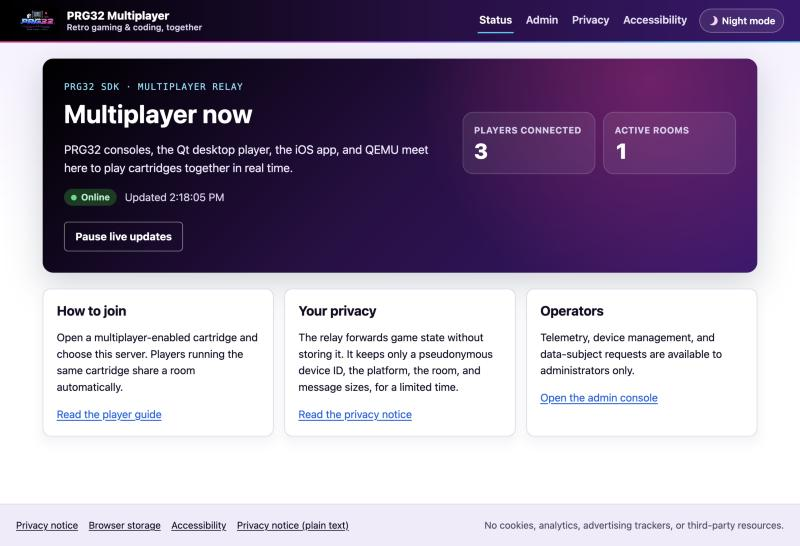

# PRG32 Multiplayer Server

A small, classroom-friendly Node.js WebSocket relay for multiplayer
[PRG32](https://github.com/riscv-prg32/PRG32) cartridges. It groups consoles by
cartridge signature, relays bounded player snapshots, and gives every client a
server connection ID plus a stable, privacy-preserving device ID.

## Quick start

Requires Node.js 22 or newer.

```bash
npm ci
cp .env.example .env
npm start
```

Health: `http://localhost:8081/healthz`. WebSocket: `ws://localhost:8081/`.
Existing PRG32 firmware is supported unchanged; new clients should send the
identity fields in [the protocol reference](docs/protocol.md).



The [POING multi-screen cartridge](examples/poing-multiplayer/README.md) is an
integration fixture for bouncing one ball across multiple QEMU/device screens.

## Documentation

- [Getting started](docs/getting-started.md)
- [Installation](docs/installation.md)
- [Configuration and deployment](docs/configuration.md)
- [Architecture](docs/architecture.md)
- [Docker and Docker Compose](docs/docker.md)
- [Protocol and device identity](docs/protocol.md)
- [Development](docs/development.md)
- [Testing](docs/testing.md)
- [Playing multiplayer games](docs/playing.md)
- [Web interface and accessibility](docs/web-interface.md)
- [Operations and security](docs/operations.md)
- [GDPR deployment guide](docs/gdpr.md)
- [Firmware enhancement specification](docs/firmware-enhancement.md)

## Commands

`npm start`, `npm run dev`, `npm test`, `npm run lint`, and `npm run check`.

## License

[MIT](LICENSE)
