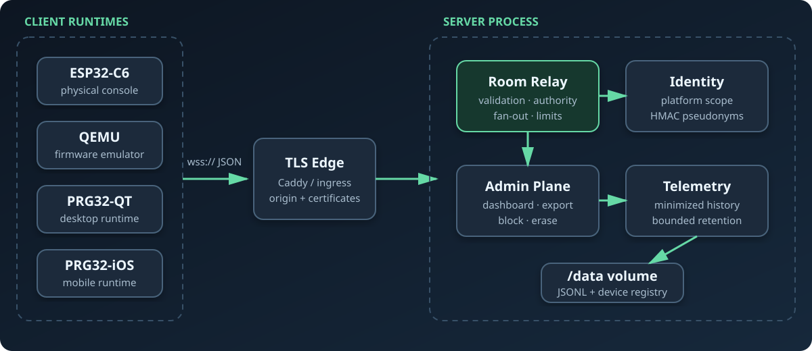
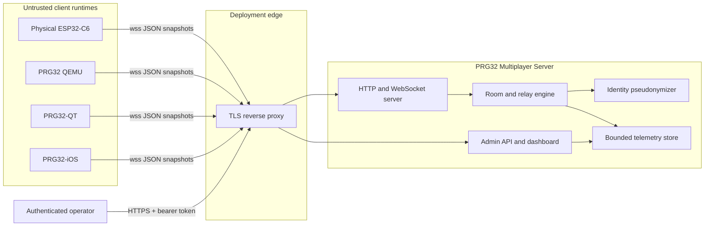
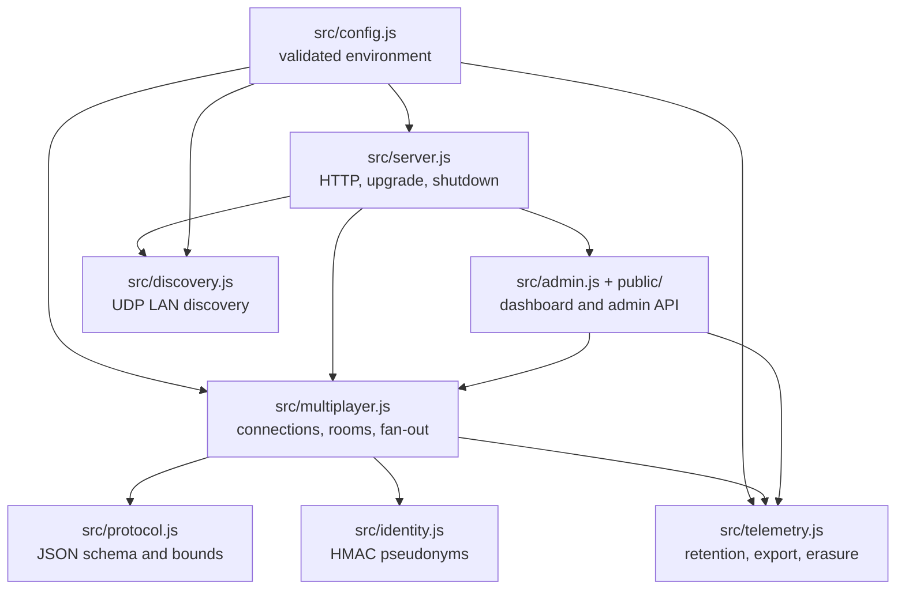
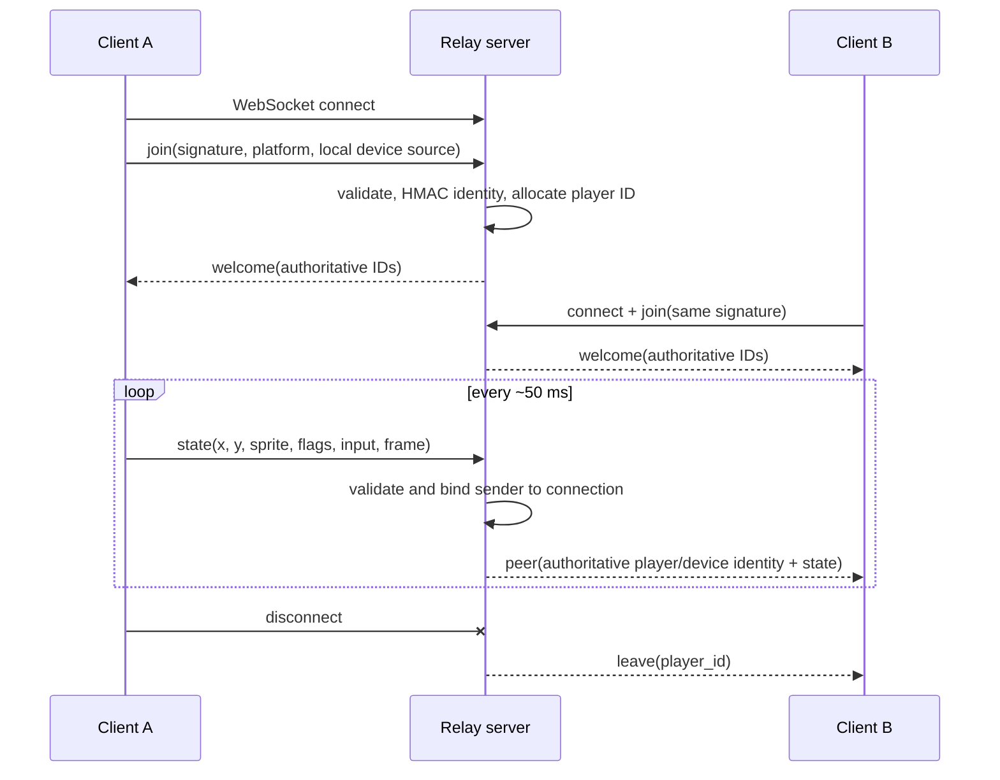
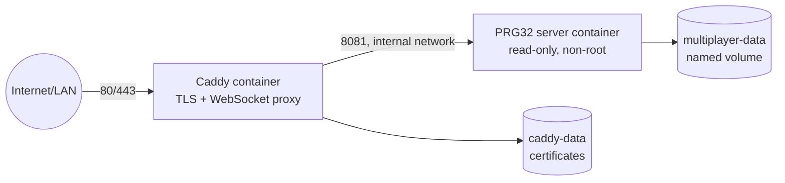
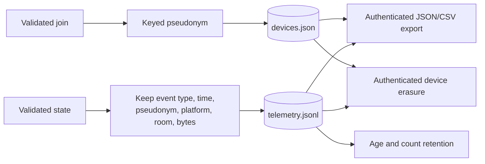
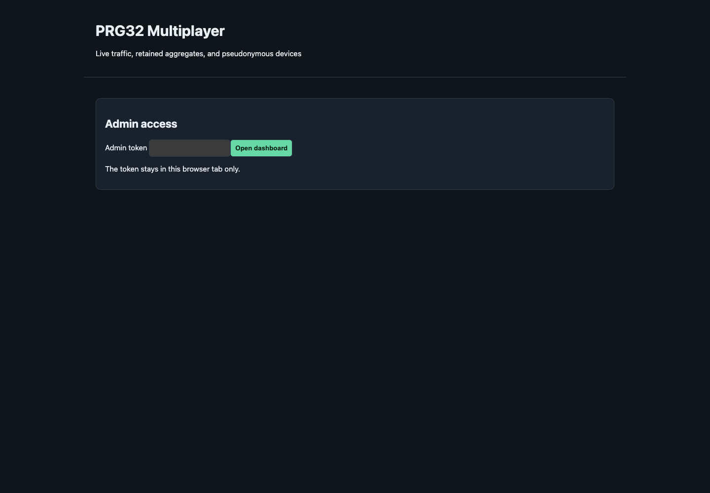
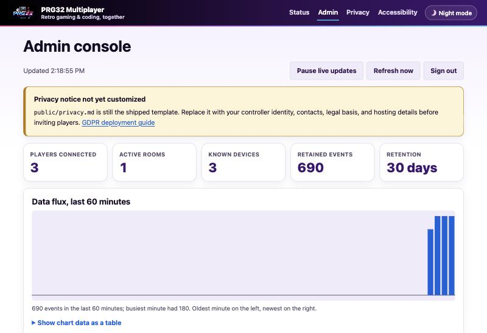

# System architecture

The PRG32 Multiplayer Server is a single-process, event-driven relay with a
small persistent administrative plane. Its separation of concerns is designed
for inspectability in systems and networking courses: the cartridge owns game
semantics, each runtime owns transport adaptation, and the server owns session
authority without becoming a game engine.

## Context and trust boundaries

Client input is untrusted even when it originates from physical firmware. The
server validates types and ranges, binds actor identity to a WebSocket session,
and enforces room/rate limits. The administrator is a separate trust domain:
the admin token authorizes telemetry export and device-management actions but
is never accepted in WebSocket URLs.

## Runtime components

The room graph and latest connection state exist only in memory. The telemetry
event history and pseudonymous device registry persist under `/data`. This is a
deliberate consistency boundary: gameplay favors low-latency transient state;
administration requires bounded history, export, and erasure.

`src/discovery.js` is a separate UDP socket (port 8082 by default) that answers
LAN discovery queries with the WebSocket URL and broadcasts it every 2 seconds;
it keeps no state. It is described in [the protocol](protocol.md#lan-discovery).

## Join and relay sequence

The server does not echo state to its sender and does not replay a latest
snapshot to a new joiner. Clients rebuild peer state from live traffic and
expire silent peers locally.

## Container deployment

The local Compose topology publishes the application directly on port 8081.
The production topology publishes only Caddy. Neither topology scales the relay
horizontally because rooms are process-local; a future distributed architecture
requires a shared membership and pub/sub backplane.

## Data lifecycle

Raw local identity sources are transformed in memory and are not written to the
persistent plane. State coordinates, controller input, and message bodies are
validated for relay but excluded from telemetry. Deployment infrastructure can
still generate access logs, so proxy and hosting policies remain part of the
GDPR boundary.

## Quality attributes and limitations

- **Compatibility:** additive JSON fields and tolerant readers permit staged
  firmware, Qt, and iOS rollout.
- **Privacy:** keyed pseudonyms, minimized telemetry, bounded retention, export,
  blocking, and erasure provide privacy-by-design mechanisms.
- **Availability:** health/readiness probes, graceful shutdown, restart policy,
  and stateless gameplay simplify recovery.
- **Security:** strict field bounds, connection-bound authority, origin policy,
  rate limits, TLS edge, non-root containers, and protected admin APIs reduce
  attack surface.
- **Reproducibility:** explicit constants, deterministic test fixtures, Compose
  topology, and protocol conformance criteria support academic experiments.
- **Limitation:** one process is one room universe; there is no cross-replica
  coordination, durable match state, human authentication, or anti-cheat game
  authority.

## Web interface

The browser pages are part of the administration plane, not the player
protocol. `src/pages.js` renders a public status page (`/`), the admin console
(`/admin`), the privacy notice (`/privacy`), and the accessibility statement
(`/accessibility`) in the shared PRG32 SDK look. The admin console begins with a
token gate; the token is retained in browser `sessionStorage` only and is sent
as an authorization header to admin APIs.

After authentication, the dashboard presents live connection/room counts,
retention, historical event flux, pseudonymous devices with export, block, and
erase actions, and recent minimized events. See [Web interface](web-interface.md)
for pages, accessibility, and privacy-by-design details.

