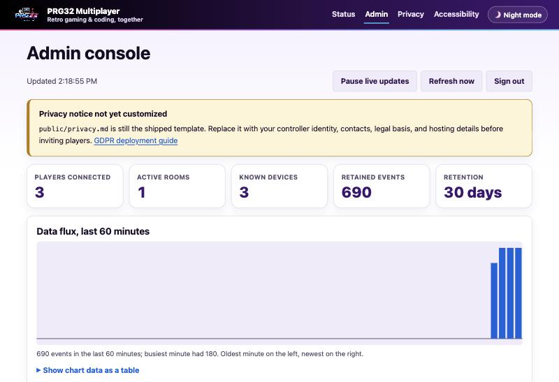

# Docker and Docker Compose deployment

This guide is the complete container operations reference for the PRG32
Multiplayer Server. It covers local evaluation, reproducible Compose operation,
public TLS deployment, persistence, upgrades, backup, observability, and
troubleshooting.

## Container contract

The production image is based on Node.js 22 Alpine and contains only production
dependencies, server sources, the administration web assets, package metadata,
and the MIT license. It runs as the unprivileged `prg32` user with these paths:

| Path/port  | Contract                                                     |
| ---------- | ------------------------------------------------------------ |
| `/app`     | read-only application and dependencies                       |
| `/data`    | writable telemetry and pseudonymous device registry          |
| `8081/tcp` | HTTP, WebSocket upgrades, dashboard, and administration API  |
| `/healthz` | liveness probe; returns HTTP 200 while the process can serve |
| `/readyz`  | readiness and current connection/room counts                 |

The image declares a health check and handles `SIGTERM` for graceful WebSocket
shutdown. No root privileges, Linux capabilities, shell entrypoint, database,
or application-level TLS implementation is required.

## Prerequisites

- Docker Engine 24 or newer, or Docker Desktop with a current Compose v2
  plugin;
- approximately 150 MB for the image and additional space proportional to the
  configured telemetry limit;
- two independent random secrets of at least 32 characters;
- for public deployment, a DNS name resolving to the host and inbound TCP ports
  80/443 plus UDP 443 if HTTP/3 is desired.

Verify the tools:

```bash
docker version
docker compose version
```

## Secret preparation

Copy the example without editing the tracked file:

```bash
cp .env.example .env
openssl rand -base64 48
openssl rand -base64 48
```

Place different generated values in `DEVICE_ID_SECRET` and `ADMIN_TOKEN`.
`.env` is ignored by Git. The first secret defines stable server pseudonyms;
rotating it changes every public device ID. The second authorizes the admin API
and dashboard. Neither value belongs in an image layer, Compose file, command
history, screenshot, support bundle, or source repository.

For managed production environments, inject these variables from the platform's
secret manager instead of a local `.env` file. Docker Compose reads `.env` for
variable interpolation; it does not copy the file into the image.

## Local Compose deployment

The default [compose.yaml](../compose.yaml) builds the source checkout, publishes
port 8081, creates a named data volume, and applies a read-only root filesystem,
no-new-privileges, capability removal, an init process, a PID limit, and health
checks.

```bash
docker compose config
docker compose build --pull
docker compose up -d
docker compose ps
curl --fail http://127.0.0.1:8081/healthz
curl --fail http://127.0.0.1:8081/readyz
```

Open `http://127.0.0.1:8081/admin` and enter `ADMIN_TOKEN`. A PRG32 client uses
`ws://HOST:8081/` on the local network. `localhost` is correct only when the
client runs on the Docker host; physical consoles use the host's LAN address.



Follow logs and stop without deleting retained data:

```bash
docker compose logs -f --tail=100 multiplayer
docker compose stop
docker compose start
docker compose down
```

`docker compose down -v` permanently removes telemetry and device-management
records. Use it only when deliberate erasure of the complete deployment is
required.

## Standalone Docker deployment

Build and inspect the image:

```bash
docker build --pull -t prg32-multiplayer-server:local .
docker image inspect prg32-multiplayer-server:local
```

Create a persistent volume and run with the same hardening as Compose:

```bash
docker volume create prg32-multiplayer-data
docker run -d \
  --name prg32-multiplayer \
  --restart unless-stopped \
  --init \
  --read-only \
  --cap-drop ALL \
  --security-opt no-new-privileges=true \
  --pids-limit 100 \
  -p 8081:8081 \
  -v prg32-multiplayer-data:/data \
  --env-file .env \
  prg32-multiplayer-server:local
```

Confirm that both the service and dashboard assets are present:

```bash
docker inspect --format '{{json .State.Health}}' prg32-multiplayer
curl --fail http://127.0.0.1:8081/healthz
curl --fail http://127.0.0.1:8081/admin >/dev/null
```

## Public TLS deployment with Compose

[compose.production.yaml](../compose.production.yaml) is a standalone production
topology. The application is exposed only to the internal Compose network;
Caddy obtains and renews certificates and proxies HTTP and WebSocket traffic.

Add these deployment-specific values to `.env`:

```dotenv
DOMAIN=multiplayer.example.edu
ACME_EMAIL=operations@example.edu
ALLOWED_ORIGINS=https://multiplayer.example.edu
IMAGE_TAG=latest
```

Then validate and start:

```bash
docker compose -f compose.production.yaml config
docker compose -f compose.production.yaml build --pull
docker compose -f compose.production.yaml up -d
docker compose -f compose.production.yaml ps
curl --fail https://multiplayer.example.edu/healthz
```

Clients use `wss://multiplayer.example.edu/`. The dashboard uses
`https://multiplayer.example.edu/admin`. Caddy persists certificates in the
`caddy-data` volume. If another ingress already terminates TLS, deploy only the
application service and preserve WebSocket upgrade headers, long-lived
connections, response streaming, and the original `Origin` header.

## Persistence and data lifecycle

The application writes `telemetry.jsonl` and `devices.json` beneath `/data`.
Compose stores them in the `multiplayer-data` named volume. Game coordinates,
controller inputs, raw identity sources, and message bodies are not persisted.
Retention and maximum-event limits are enforced by the application.

List and locate the volume:

```bash
docker volume inspect prg32-multiplayer-server_multiplayer-data
```

Back up while the application is stopped so the two files represent one
consistent point in time:

```bash
docker compose stop multiplayer
docker run --rm \
  -v prg32-multiplayer-server_multiplayer-data:/source:ro \
  -v "$PWD/backups:/backup" \
  alpine sh -c 'tar -C /source -czf /backup/prg32-data.tgz .'
docker compose start multiplayer
```

Treat backups as personal data: encrypt them, restrict access, give them an
expiry compatible with the privacy notice, and include them in erasure policy.
To restore, stop the service and extract a trusted backup into an empty named
volume before restarting. Never merge JSONL files from two active instances.

## Upgrade and rollback

Before an upgrade, review release notes, back up `/data`, and record the running
image digest:

```bash
docker compose images
docker image inspect --format '{{index .RepoDigests 0}}' prg32-multiplayer-server:local
```

For a source deployment:

```bash
git pull --ff-only
docker compose build --pull
docker compose up -d --remove-orphans
docker compose ps
```

Compose replaces the application container but retains the named volume.
Existing WebSockets reconnect and rejoin according to the protocol lifecycle.
Rollback by checking out the previous reviewed revision, rebuilding, and
starting it against a compatible backup. Do not assume that future persistent
formats are backward compatible unless their release notes say so.

## Capacity and scaling

One application process owns an in-memory room graph. Multiple replicas do not
share peer state; a load balancer would split one room across processes. Run a
single replica unless a shared room/pub-sub backplane is implemented. Vertical
capacity is controlled with `MAX_CONNECTIONS`, `MAX_ROOM_CLIENTS`, message size,
rate, and retention limits.

At 20 state messages per second per active player, telemetry can reach the
event limit quickly in large classrooms. Choose retention and event caps based
on a documented purpose and storage budget. Monitor `/readyz`, container CPU,
memory, filesystem usage, restart count, and proxy connection metrics.

## Troubleshooting

### Compose reports a missing variable

Both secrets are mandatory in production. Confirm `.env` exists in the current
directory and run `docker compose config`; do not paste secret-bearing output
into public issue reports.

### Container is unhealthy or restarts

```bash
docker compose ps
docker compose logs --tail=200 multiplayer
docker inspect --format '{{json .State.Health}}' prg32-multiplayer-server-local
```

Common causes are short/missing secrets, an unwritable `/data` mount, a port
collision, or malformed numeric environment variables.

### Dashboard returns 404 or blank content

Rebuild the current image without an old cache and verify `/app/public` exists:

```bash
docker compose build --pull --no-cache multiplayer
docker compose run --rm --no-deps multiplayer ls -la /app/public
```

### Physical devices cannot connect

Use the Docker host's LAN address, allow TCP 8081 through the host firewall for
local deployments, confirm both devices can route to that subnet, and avoid
client isolation on the Wi-Fi access point. For TLS, verify DNS and certificate
trust, then use `wss://`, not `ws://`.

### Permission error under `/data`

The image runs as user `prg32`. The supplied named volume is initialized
correctly. For a bind mount, make the host directory writable by the container
user without making it world-writable. Rootless Docker with a named volume is
preferred when available.

## Container validation checklist

Before publishing an image:

1. Run `docker compose config` with non-production test secrets.
2. Build with `docker build --pull` and inspect the MIT OCI license label.
3. Start with a new named volume and wait for healthy status.
4. Retrieve `/healthz`, `/readyz`, `/`, `/admin`, `/privacy`, `/accessibility`,
   `/style.css`, and `/app.js`.
5. Join three WebSocket clients, relay state, and confirm dashboard statistics.
6. Restart the container and confirm retained telemetry/devices return.
7. Export data, block/unblock a device, and exercise erasure.
8. Send `SIGTERM` and confirm graceful exit within the stop grace period.
9. Run the Node test matrix and scan the final image in CI.
