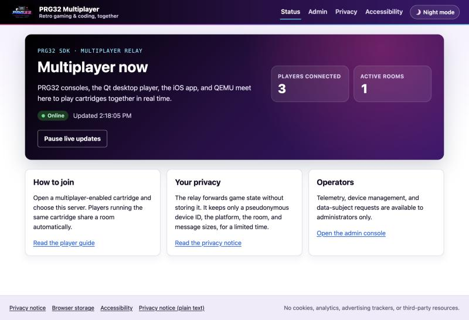
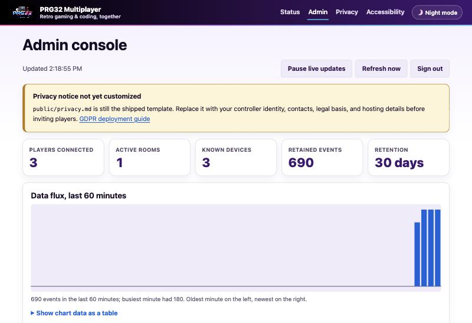
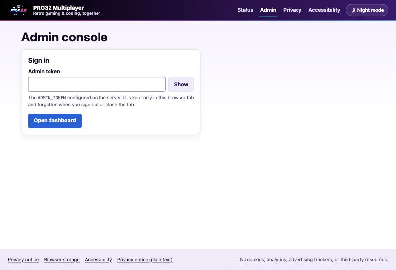

# Web interface

The server ships a small set of web pages for players and operators. They
follow the visual language of the PRG32 SDK family (PRG32 Construction Kit and
Cartridge Store): the colours of the official PRG32 logo, the deep purple menu
bar with the neon underline, a Day/Night switch, and a footer that links the
privacy notice and the accessibility statement.

## Pages and assets

| Path                              | Content                                                               |
| --------------------------------- | --------------------------------------------------------------------- |
| `/`                               | Public status: live connection and room counts, how to join, privacy  |
| `/admin`                          | Admin console: sign-in, then telemetry, devices, data-subject actions |
| `/privacy`                        | Privacy notice rendered from `public/privacy.md`                      |
| `/privacy.md`                     | The same notice as plain Markdown                                     |
| `/accessibility`                  | Accessibility statement rendered from `public/accessibility.md`       |
| `/style.css`, `/*.js`             | Stylesheet and scripts (`theme.js`, `status.js`, `app.js`)            |
| `/prg32-logo.png`, `/favicon.png` | The official PRG32 logo and icon                                      |

Pages are assembled by `src/pages.js` from a shared shell (header, navigation,
footer) and a body: `public/status.html`, `public/admin.html`, or a Markdown
notice rendered by `src/markdown.js`. Only a fixed allowlist of files is served;
request paths never reach the filesystem.

The notices support a small Markdown subset: `#` headings, paragraphs, `-` and
`1.` lists, `**bold**`, `` `code` ``, and `[links](https://…)`. All text is
escaped, and only `https:`, `http:`, `mailto:`, same-site, and `#` links are
rendered, so an edited notice cannot inject markup. HTML comments are dropped.
In the privacy notice, `{{retention_days}}` is replaced by the configured
`TELEMETRY_RETENTION_DAYS`.

The navigation's Privacy link follows `PRIVACY_NOTICE_URL`, so an operator can
point it at an institutional notice instead.

## Admin console

After signing in with `ADMIN_TOKEN`, the console shows live counts, retention,
a 60-minute event chart (with a text summary and a data table), the device list,
and the 100 most recent events. Updates run every ten seconds and can be paused.

For data-subject requests, the operator searches for the public device ID and
can **Export** everything retained about that device as JSON
(`GET /api/admin/devices/<id>/export`), **Block** or **Unblock** it, or
**Erase** it after confirming in a dialog. **Sign out** removes the token from
the browser. A warning is shown while `public/privacy.md` is still the shipped
template (see [GDPR deployment guide](gdpr.md)).

## Privacy by design

- No cookies, analytics, advertising, or third-party fonts, scripts, or images.
  Every page loads only from this server, enforced by a strict
  `Content-Security-Policy` (`default-src 'none'`), with
  `Referrer-Policy: no-referrer` and a restrictive `Permissions-Policy`.
- The public page shows only aggregate counts.
- Browser storage is limited to what the visitor asks for: the Day/Night choice
  (`localStorage`, `prg32-theme`, only after using the switch) and the admin token
  (`sessionStorage`, `prg32-admin-token`, this tab only, removed on sign-out).
  Both are disclosed in the privacy notice.

## Accessibility

The pages target **WCAG 2.2 level AA** and EN 301 549:

- landmarks, a skip link, one `h1` per page, `aria-current` navigation;
- full keyboard operation, a visible focus ring, focus kept in place when live
  data refreshes, and focus returned after the erase dialog closes;
- AA contrast for text and controls in Day and Night; respect for
  `prefers-color-scheme`, `prefers-reduced-motion`, and forced-colours modes;
- pausable live updates (WCAG 2.2.2) that do not spam screen readers, with a
  polite status region for the result of each action;
- the chart exposed as an image with a text summary plus a data table;
- labelled fields with hints and errors linked through `aria-describedby`;
- buttons named with the device they act on, tables with captions and column
  headers, and keyboard-scrollable table regions;
- 44 px primary targets, reflow to 320 CSS px, and 200 % text zoom.

Operators publishing the service, especially public-sector bodies, should
replace the placeholders in `public/accessibility.md` with their contact and
enforcement details and record the date of their own review.
